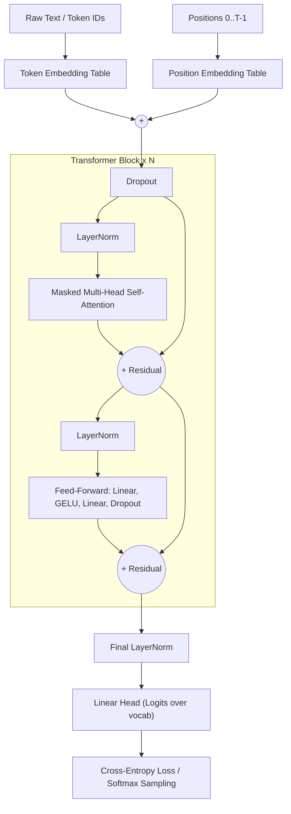

<div align="center">

# 🧠 Building GPT from Scratch: NanoGPT
*From mathematical first principles to a Generative Pre-trained Transformer*

[](https://www.python.org/)
[](https://pytorch.org/)
[](https://opensource.org/licenses/MIT)
[]()

*Inspired by Andrej Karpathy's **Neural Networks: Zero to Hero** and the paper **"Attention Is All You Need"**.*

</div>

---

## 📖 Table of Contents

1. [Overview](#-overview)
2. [What You Will Learn](#-what-you-will-learn)
3. [Architecture](#%EF%B8%8F-architecture)
4. [The Math Behind Self-Attention](#-the-math-behind-self-attention)
5. [Key Features](#-key-features)
6. [Quick Start](#%EF%B8%8F-quick-start)
7. [Repository Structure](#-repository-structure)
8. [Hyperparameters](#-hyperparameters)
9. [Code Walkthrough](#-code-walkthrough)
10. [Training & Generation](#-training--generation)
11. [Results](#-results)
12. [Build Journey](#-build-journey)
13. [Troubleshooting](#-troubleshooting)
14. [Roadmap](#-roadmap)
15. [References & Acknowledgments](#-references--acknowledgments)
16. [License](#-license)

---

## ✨ Overview

This repository is a hands-on implementation of a **decoder-only Generative Pre-trained Transformer (GPT)** written from scratch in **PyTorch**. Instead of treating language models as black boxes, the project rebuilds one piece by piece, starting from a trivial bigram model and ending with a multi-layer transformer that generates text one character at a time.

The model is trained on a small text corpus (TinyShakespeare by default) with a **character-level tokenizer**. This keeps the vocabulary tiny (about 65 symbols), so the focus stays on the transformer itself rather than on tokenization or data engineering.

> **Goal:** understand every line. No `nn.Transformer`, no HuggingFace, no hidden abstractions. Just tensors, matrix multiplications, and `nn.Module`.

---

## 🎓 What You Will Learn

| Concept | Where it shows up |
|---|---|
| Character-level tokenization (encode / decode) | `train.py` data pipeline |
| Batching with context windows (`block_size`) | `get_batch()` |
| Language modeling as next-token prediction | Cross-entropy loss over logits |
| The "mathematical trick" of weighted aggregation | Lower-triangular matrix + softmax |
| Self-attention (queries, keys, values) | `Head` |
| Multi-head attention | `MultiHeadAttention` |
| Position-wise feed-forward networks | `FeedForward` |
| Residual connections and LayerNorm | `Block` |
| Autoregressive sampling (temperature, multinomial) | `GPT.generate()` |
| Regularization and optimization (dropout, AdamW) | `train.py` |

---

## 🏗️ Architecture

The model follows the decoder-only transformer design used by GPT-2, with **pre-LayerNorm** blocks.



### Shape Flow

For a batch of `B` sequences, each `T` tokens long, with embedding width `C = n_embd`:

| Stage | Shape |
|---|---|
| Input token IDs | `(B, T)` |
| Token embeddings + position embeddings | `(B, T, C)` |
| Each transformer block (in and out) | `(B, T, C)` |
| Per-head Q, K, V | `(B, T, head_size)` |
| Attention matrix per head | `(B, T, T)` |
| Final logits | `(B, T, vocab_size)` |

### Parameter Count

With the default configuration (`n_embd=384`, `n_layer=6`, `vocab≈65`), the model has roughly **10.7M parameters**. Each transformer block contributes about 1.77M of them (attention projections `4·C²` plus feed-forward `8·C²`).

---

## 🔬 The Math Behind Self-Attention

Self-attention lets every token look at all earlier tokens and decide how much each one matters.

For an input `X` of shape `(T, C)`, three learned linear maps produce:

```
Q = X · W_q      (what am I looking for?)
K = X · W_k      (what do I contain?)
V = X · W_v      (what will I share if attended to?)
```

The attention output is:

```
Attention(Q, K, V) = softmax( (Q · Kᵀ) / √d_k  +  M ) · V
```

where:

- **`√d_k` scaling** keeps the dot products from growing with head size. Without it, softmax saturates into near one-hot distributions early in training and gradients vanish.
- **`M` is the causal mask**: `0` on and below the diagonal, `-∞` above it. After softmax, the `-∞` entries become exactly zero, so token `t` can never attend to tokens `t+1, t+2, …`.
- **Multi-head attention** runs `h` independent attention operations in lower-dimensional subspaces (`head_size = C / h`), concatenates the results, and mixes them with a final linear projection.

### The "Weighted Aggregation" Intuition

The simplest version of this idea is averaging over past tokens with a lower-triangular matrix:

```python
tril = torch.tril(torch.ones(T, T))
wei = tril / tril.sum(1, keepdim=True)   # each row averages the tokens so far
out = wei @ x                            # (T, T) @ (T, C) -> (T, C)
```

Self-attention replaces this fixed uniform average with **data-dependent weights**, computed from `Q · Kᵀ`.

---

## 🚀 Key Features

- 🧠 **Scaled dot-product self-attention:** the communication mechanism that routes information between tokens.
- ⚡ **Multi-head attention:** parallel attention subspaces that capture different relationships at once.
- 🛡️ **Causal masking:** a lower-triangular mask that enforces autoregressive behavior.
- 🔗 **Residual connections + pre-LayerNorm:** stable training for deeper stacks.
- 📈 **Learned token and position embeddings:** map discrete tokens and absolute positions into continuous space.
- 🎲 **Autoregressive generation:** sample new text with multinomial sampling, optional temperature and top-k.
- 💾 **Checkpointing:** save and resume training.

---

## 🛠️ Quick Start

### Prerequisites

- Python 3.8+
- PyTorch 2.0+
- A GPU is strongly recommended (CUDA or Apple Silicon `mps`). CPU works with a scaled-down config (see [Hyperparameters](#-hyperparameters)).

### 1. Clone & navigate

```bash
git clone https://github.com/riyagoyal08010-glitch/nano-gpt-karpathy.git
cd nano-gpt-karpathy
```

### 2. Set up the environment

```bash
conda create -n nanogpt python=3.10 -y
conda activate nanogpt
pip install torch torchvision torchaudio
pip install tqdm numpy matplotlib
```

Or with `venv`:

```bash
python -m venv .venv
source .venv/bin/activate        # Windows: .venv\Scripts\activate
pip install torch numpy tqdm matplotlib
```

### 3. Get the data

```bash
mkdir -p data
curl -L https://raw.githubusercontent.com/karpathy/char-rnn/master/data/tinyshakespeare/input.txt -o data/input.txt
```

### 4. Train

```bash
python train.py
```

### 5. Generate text

Use the generation snippet from [Training & Generation](#-training--generation) after training completes.

---

## 📂 Repository Structure

```text
📦 nano-gpt-karpathy/
│
├── 📜 train.py            # Training script: data loading, batching, optimization loop, eval
├── 📜 model.py            # Transformer: Head, MultiHeadAttention, FeedForward, Block, GPT
├── 📂 data/
│   └── input.txt          # TinyShakespeare (or any plain-text corpus)
├── 📂 notebooks/          # (optional) step-by-step walkthrough notebooks
├── 📂 checkpoints/        # (optional) saved model weights
└── 📜 README.md           # You are here
```

---

## 📊 Hyperparameters

| Hyperparameter | Description | Default |
|---|---|---|
| `batch_size` | Independent sequences processed in parallel | `64` |
| `block_size` | Maximum context length (prediction window) | `256` |
| `n_embd` | Embedding dimension (hidden channel width) | `384` |
| `n_head` | Number of attention heads (`head_size = n_embd / n_head = 64`) | `6` |
| `n_layer` | Number of stacked transformer blocks | `6` |
| `dropout` | Dropout probability | `0.2` |
| `learning_rate` | Peak learning rate for AdamW | `3e-4` |
| `max_iters` | Total training iterations | `5000` |
| `eval_interval` | Steps between loss evaluations | `500` |
| `eval_iters` | Batches averaged per evaluation | `200` |

### Small Config for CPU / Laptops

If you do not have a GPU, shrink the model so it trains in a few minutes:

```python
batch_size = 32
block_size = 64
n_embd = 128
n_head = 4
n_layer = 4
dropout = 0.0
learning_rate = 1e-3
max_iters = 3000
```

> **Rule of thumb:** `n_embd` must be divisible by `n_head`.

---

## 💡 Code Walkthrough

### 1. Single Head of Causal Self-Attention

```python
class Head(nn.Module):
    """One head of self-attention."""

    def __init__(self, head_size):
        super().__init__()
        self.key = nn.Linear(n_embd, head_size, bias=False)
        self.query = nn.Linear(n_embd, head_size, bias=False)
        self.value = nn.Linear(n_embd, head_size, bias=False)
        self.register_buffer('tril', torch.tril(torch.ones(block_size, block_size)))
        self.dropout = nn.Dropout(dropout)

    def forward(self, x):
        B, T, C = x.shape
        k = self.key(x)     # (B, T, hs)
        q = self.query(x)   # (B, T, hs)

        # Attention scores ("affinities"), scaled by sqrt(head_size)
        wei = q @ k.transpose(-2, -1) * (k.shape[-1] ** -0.5)        # (B, T, T)
        wei = wei.masked_fill(self.tril[:T, :T] == 0, float('-inf')) # causal mask
        wei = F.softmax(wei, dim=-1)
        wei = self.dropout(wei)

        # Weighted aggregation of values
        v = self.value(x)   # (B, T, hs)
        return wei @ v      # (B, T, T) @ (B, T, hs) -> (B, T, hs)
```

> **Note:** the scaling factor uses `head_size` (the key dimension), as in the original paper, not the full embedding width `C`.

### 2. Multi-Head Attention

```python
class MultiHeadAttention(nn.Module):
    """Multiple attention heads in parallel, followed by a projection."""

    def __init__(self, num_heads, head_size):
        super().__init__()
        self.heads = nn.ModuleList([Head(head_size) for _ in range(num_heads)])
        self.proj = nn.Linear(n_embd, n_embd)
        self.dropout = nn.Dropout(dropout)

    def forward(self, x):
        out = torch.cat([h(x) for h in self.heads], dim=-1)  # (B, T, n_embd)
        return self.dropout(self.proj(out))
```

### 3. Feed-Forward Network

```python
class FeedForward(nn.Module):
    """Per-token MLP with a 4x hidden expansion."""

    def __init__(self, n_embd):
        super().__init__()
        self.net = nn.Sequential(
            nn.Linear(n_embd, 4 * n_embd),
            nn.GELU(),
            nn.Linear(4 * n_embd, n_embd),
            nn.Dropout(dropout),
        )

    def forward(self, x):
        return self.net(x)
```

### 4. Transformer Block (communication, then computation)

```python
class Block(nn.Module):
    def __init__(self, n_embd, n_head):
        super().__init__()
        head_size = n_embd // n_head
        self.sa = MultiHeadAttention(n_head, head_size)
        self.ffwd = FeedForward(n_embd)
        self.ln1 = nn.LayerNorm(n_embd)
        self.ln2 = nn.LayerNorm(n_embd)

    def forward(self, x):
        x = x + self.sa(self.ln1(x))     # tokens communicate
        x = x + self.ffwd(self.ln2(x))   # tokens compute individually
        return x
```

### 5. The Full GPT Model

```python
class GPT(nn.Module):
    def __init__(self):
        super().__init__()
        self.token_embedding_table = nn.Embedding(vocab_size, n_embd)
        self.position_embedding_table = nn.Embedding(block_size, n_embd)
        self.drop = nn.Dropout(dropout)
        self.blocks = nn.Sequential(*[Block(n_embd, n_head) for _ in range(n_layer)])
        self.ln_f = nn.LayerNorm(n_embd)
        self.lm_head = nn.Linear(n_embd, vocab_size)

    def forward(self, idx, targets=None):
        B, T = idx.shape
        tok_emb = self.token_embedding_table(idx)                              # (B, T, C)
        pos_emb = self.position_embedding_table(torch.arange(T, device=idx.device))  # (T, C)
        x = self.drop(tok_emb + pos_emb)
        x = self.blocks(x)
        x = self.ln_f(x)
        logits = self.lm_head(x)                                               # (B, T, vocab)

        loss = None
        if targets is not None:
            B, T, V = logits.shape
            loss = F.cross_entropy(logits.view(B * T, V), targets.view(B * T))
        return logits, loss

    @torch.no_grad()
    def generate(self, idx, max_new_tokens, temperature=1.0, top_k=None):
        for _ in range(max_new_tokens):
            idx_cond = idx[:, -block_size:]                 # crop to context window
            logits, _ = self(idx_cond)
            logits = logits[:, -1, :] / temperature         # last time step only
            if top_k is not None:
                v, _ = torch.topk(logits, top_k)
                logits[logits < v[:, [-1]]] = float('-inf')
            probs = F.softmax(logits, dim=-1)
            idx_next = torch.multinomial(probs, num_samples=1)
            idx = torch.cat((idx, idx_next), dim=1)
        return idx
```

---

## 🏋️ Training & Generation

### Training Loop (core idea)

```python
optimizer = torch.optim.AdamW(model.parameters(), lr=learning_rate)

for it in range(max_iters):
    if it % eval_interval == 0:
        losses = estimate_loss()
        print(f"step {it}: train {losses['train']:.4f}, val {losses['val']:.4f}")

    xb, yb = get_batch('train')
    logits, loss = model(xb, yb)
    optimizer.zero_grad(set_to_none=True)
    loss.backward()
    optimizer.step()
```

### Generating Text

```python
model.eval()
context = torch.zeros((1, 1), dtype=torch.long, device=device)  # start from token 0
out = model.generate(context, max_new_tokens=500, temperature=0.8, top_k=40)
print(decode(out[0].tolist()))
```

### Sampling Knobs

| Setting | Effect |
|---|---|
| `temperature < 1` | Sharper distribution: safer, more repetitive text |
| `temperature > 1` | Flatter distribution: more creative, more errors |
| `top_k` | Samples only from the `k` most likely tokens |

---

## 📈 Results

> Fill these in with your own runs.

| Model | Params | Train loss | Val loss | Hardware | Time |
|---|---|---|---|---|---|
| Bigram baseline | ~4K | _TBD_ | _TBD_ | _TBD_ | _TBD_ |
| Single-head attention | _TBD_ | _TBD_ | _TBD_ | _TBD_ | _TBD_ |
| Full GPT (6 layers, 6 heads) | ~10.7M | _TBD_ | _TBD_ | _TBD_ | _TBD_ |

### Sample Output

```text
<paste a generated sample here>
```

### Loss Curve

```text

```

---

## 🧭 Build Journey

The project is built in stages, each adding one idea on top of the previous one:

1. **Data and tokenization:** read the corpus, build the character vocabulary, encode and decode.
2. **Batching:** sample random `(x, y)` windows where `y` is `x` shifted by one token.
3. **Bigram language model:** a single embedding table predicting the next token from the current one.
4. **Weighted aggregation trick:** use a lower-triangular matrix to average past tokens (three equivalent ways, ending with softmax).
5. **Single-head self-attention:** replace uniform averaging with data-dependent query-key affinities.
6. **Multi-head attention:** run several heads in parallel and concatenate.
7. **Feed-forward layer:** add per-token computation after communication.
8. **Residual connections:** make deeper networks optimizable.
9. **LayerNorm:** stabilize activations (pre-norm formulation).
10. **Scaling up:** add dropout, more layers and heads, and train on a GPU.

---

## 🩺 Troubleshooting

| Problem | Likely cause | Fix |
|---|---|---|
| `CUDA out of memory` | Model or batch too large | Lower `batch_size` or `block_size` first |
| Loss is `nan` | Learning rate too high | Try `1e-4`; check for `-inf` rows in the mask |
| Train loss falls but val loss rises | Overfitting on a small corpus | Raise `dropout`, shrink the model, or add data |
| Output is gibberish | Undertrained | Train longer; confirm loss has stopped dropping |
| Output repeats itself | Temperature too low | Raise `temperature` or set `top_k` |
| `RuntimeError: shape mismatch` | `n_embd` not divisible by `n_head` | Pick compatible values |
| Very slow on CPU | Default config is GPU-sized | Use the small config above |

---

## 🗺️ Roadmap

- [ ] Add checkpoint save and resume
- [ ] Add a standalone `generate.py` CLI
- [ ] Swap in Flash Attention via `F.scaled_dot_product_attention`
- [ ] Learning-rate warmup and cosine decay
- [ ] Gradient clipping and mixed-precision (`torch.autocast`) training
- [ ] Byte-pair encoding (BPE) tokenizer instead of characters
- [ ] Weight tying between the token embedding and output head
- [ ] Training on a larger dataset (OpenWebText subset)
- [ ] Loading pretrained GPT-2 weights for comparison
- [ ] Attention-map visualization notebook

---

## 🎯 References & Acknowledgments

- **Andrej Karpathy:** [Neural Networks: Zero to Hero](https://karpathy.ai/zero-to-hero.html), [nanoGPT](https://github.com/karpathy/nanoGPT), and the "Let's build GPT" lecture.
- **Vaswani et al. (2017):** [Attention Is All You Need](https://arxiv.org/abs/1706.03762).
- **Radford et al. (2019):** [Language Models are Unsupervised Multitask Learners](https://cdn.openai.com/better-language-models/language_models_are_unsupervised_multitask_learners.pdf) (GPT-2).
- **Brown et al. (2020):** [Language Models are Few-Shot Learners](https://arxiv.org/abs/2005.14165) (GPT-3).
- **Ba et al. (2016):** [Layer Normalization](https://arxiv.org/abs/1607.06450).
- **He et al. (2015):** [Deep Residual Learning for Image Recognition](https://arxiv.org/abs/1512.03385).

---

## 📄 License

Distributed under the MIT License. See `LICENSE` for details.

<div align="center">

⭐ If this helped you understand transformers, consider starring the repo!

</div>
